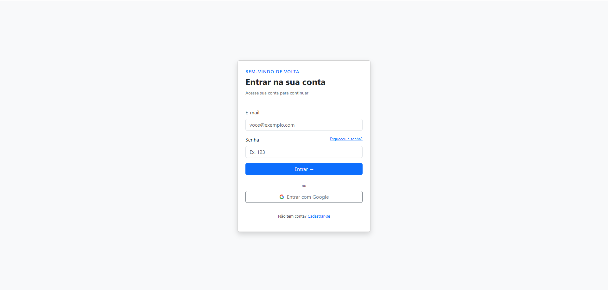
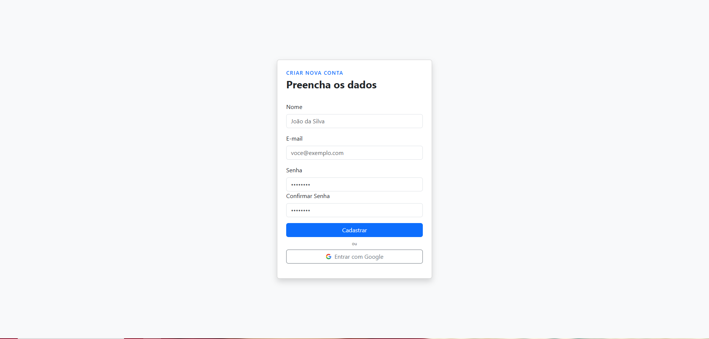
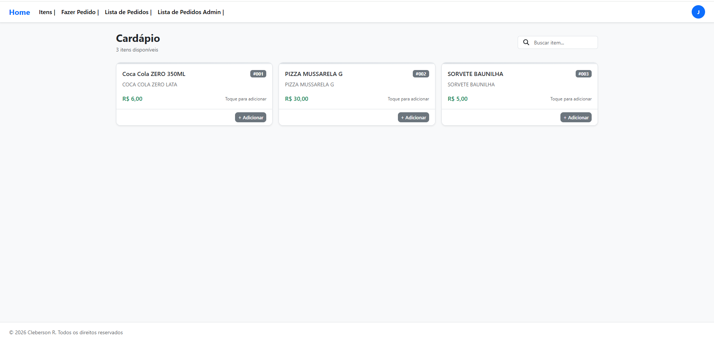
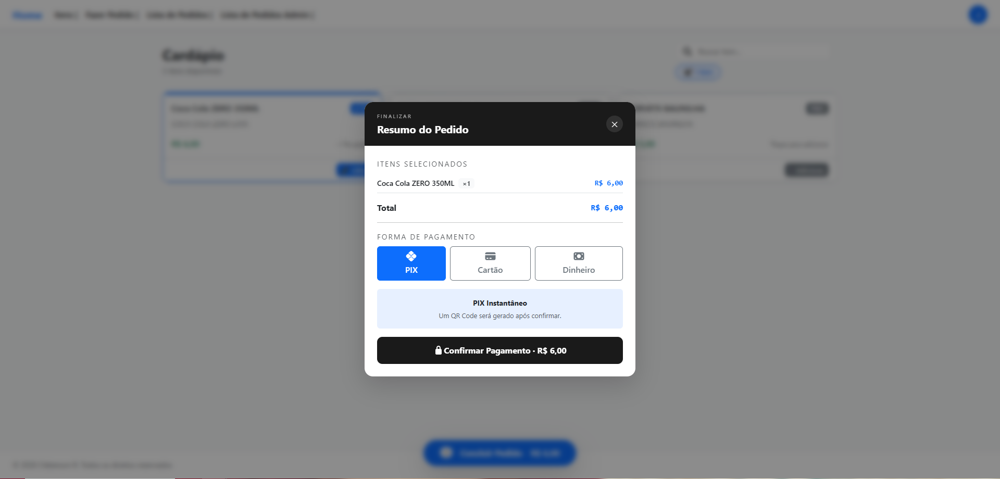
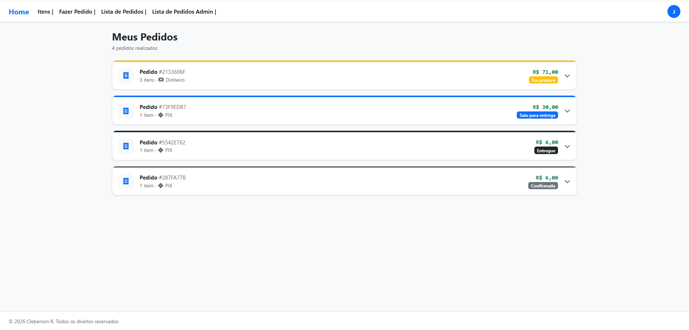
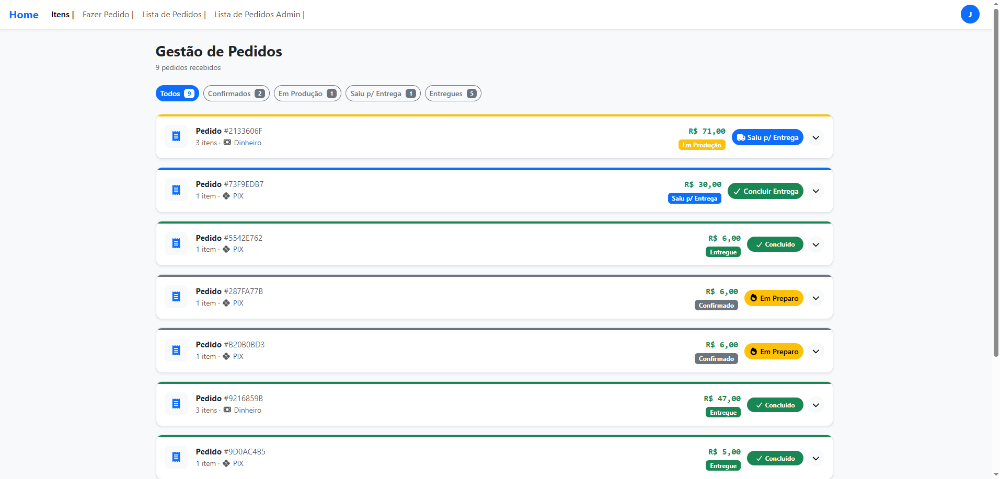
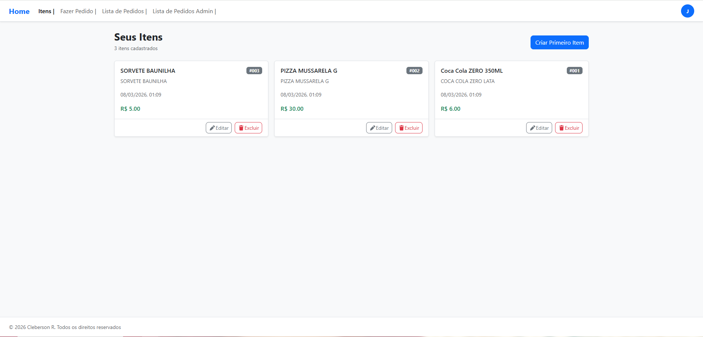

<div align="center">

# Flash Food

Sistema de pedidos online inspirado em plataformas de delivery.


</div>

---

## Sobre o projeto

Flash Food é uma aplicação web inspirada em plataformas de delivery.
O sistema simula o fluxo completo de um pedido online, permitindo que usuários visualizem produtos, adicionem itens ao carrinho, realizem pedidos e acompanhem o status da entrega.

Além disso, existe um painel administrativo onde é possível gerenciar produtos e controlar o andamento dos pedidos.

O projeto foi desenvolvido como parte do meu portfólio para demonstrar a criação de uma aplicação web completa utilizando **Laravel no backend e React no frontend**.

---

# Preview da aplicação

## Criação e Login




Com as atuatenticações principais em uma tela de Login.

---
## Cardápio



Interface onde o cliente pode visualizar os produtos disponíveis e adicioná-los ao carrinho.

---

## Resumo do pedido



Tela responsável pela finalização do pedido e seleção da forma de pagamento.

---

## Histórico de pedidos



O cliente pode acompanhar todos os pedidos realizados e verificar o status atual.

---

## Gestão administrativa de pedidos



Painel administrativo onde é possível visualizar e atualizar o status dos pedidos.

Fluxo de status:

Confirmado
Em preparo
Saiu para entrega
Entregue

---

## Gerenciamento de itens



Tela administrativa para criação, edição e remoção de produtos.

---

# Tecnologias utilizadas

## Backend

* Laravel
* Eloquent ORM

## Frontend

* React
* Inertia.js
* Vite

## Banco de dados

* MySQL

---

# Funcionalidades

## Cliente

* Criação de conta
* Login de usuário
* Listagem de produtos
* Busca de produtos
* Adição de itens ao carrinho
* Seleção de forma de pagamento
* Criação de pedidos
* Visualização do status do pedido
* Histórico de pedidos

## Administração

* Cadastro de produtos
* Edição de produtos
* Remoção de produtos
* Visualização de pedidos
* Atualização do status dos pedidos

---

# Fluxo do sistema

1. O usuário cria uma conta ou realiza login
2. O usuário visualiza os produtos disponíveis
3. Produtos podem ser adicionados ao carrinho
4. O pedido é finalizado com seleção da forma de pagamento
5. O pedido é registrado no sistema
6. O administrador atualiza o status do pedido
7. O usuário acompanha o andamento diretamente na aplicação

---

# Estrutura do banco de dados

Principais entidades do sistema:

```
Users
Products
Orders
```

Relacionamentos principais:

* Um usuário pode possuir vários pedidos
* Um pedido possui vários itens
* Cada item de pedido pertence a um produto

---

# Instalação do projeto

Clone o repositório

```
git clone https://github.com/Cleberson2004/FlashFood.git
```

Acesse o diretório do projeto

```
cd FlashFood
```

Instale as dependências do backend

```
composer install
```

Instale as dependências do frontend

```
npm install
```

Configure o arquivo `.env`

```
cp .env.example .env
```

Execute as migrations

```
php artisan migrate
```

Inicie o servidor

```
php artisan serve
npm run dev
```

---

# Melhorias futuras

* Dashboard administrativo com métricas de pedidos
* Sistema de categorias de produtos
* Upload de imagens para produtos
* Sistema de avaliações
* Atualizações de pedidos em tempo real

---

# Autor

Cleberson Ribeiro
